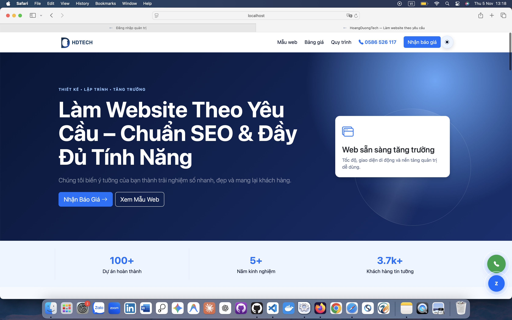
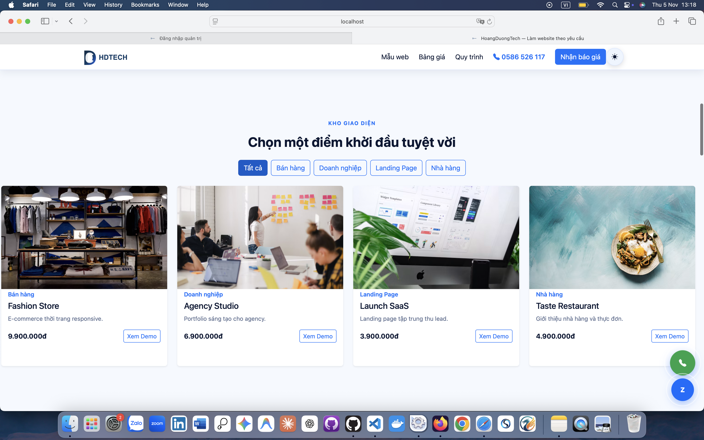
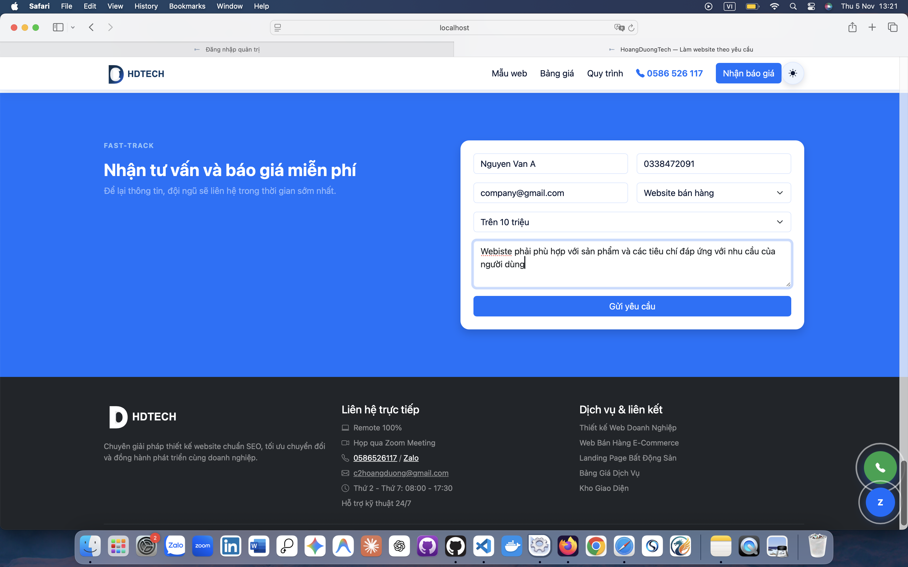
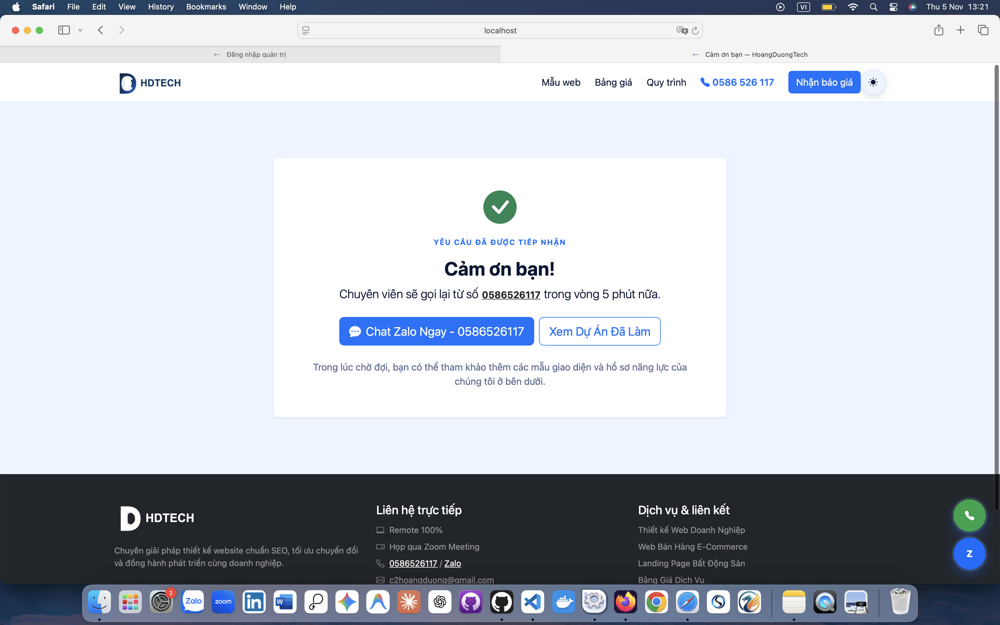
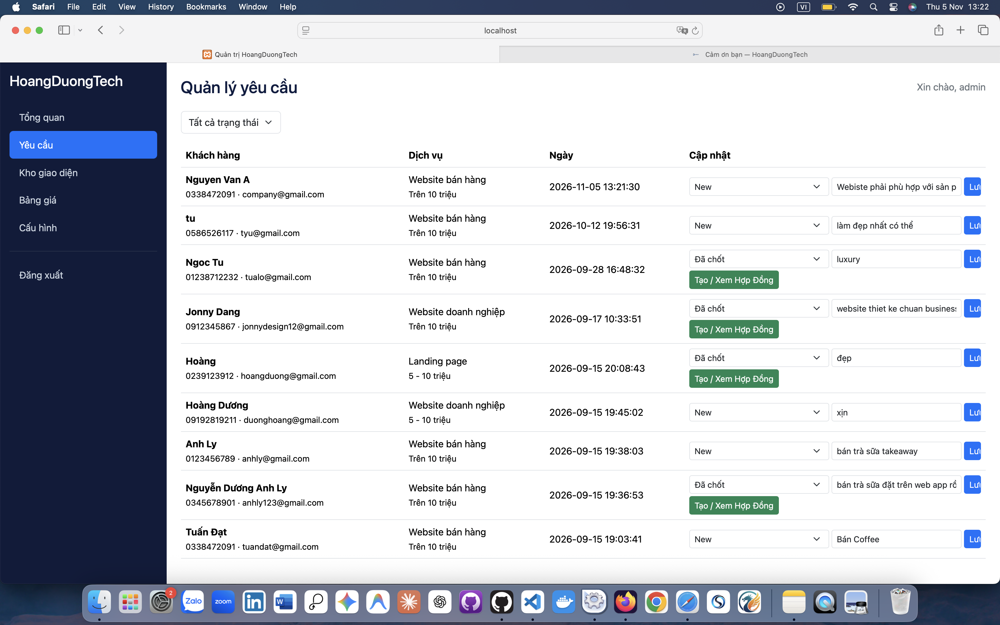
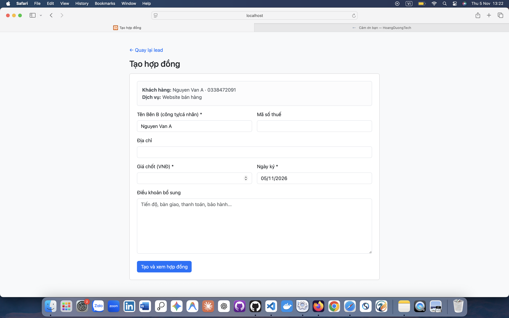
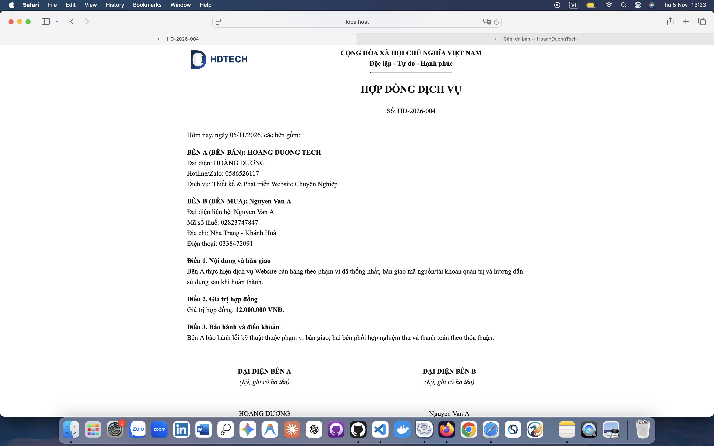
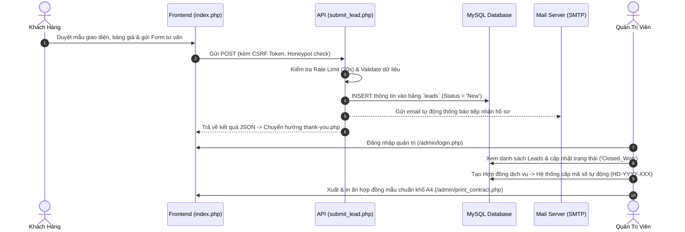

# HoangDuongTech – Nền Tảng Dịch Vụ Thiết Kế & Phát Triển Website Theo Yêu Cầu

> **HoangDuongTech** là giải pháp web trọn gói dành cho doanh nghiệp và agency cung cấp dịch vụ thiết kế, lập trình web chuyên nghiệp. Dự án được tối ưu hóa toàn diện từ trải nghiệm người dùng (UX/UI hiện đại với hiệu ứng 3D, Dark/Light Mode, Animation mượt mà) cho đến hệ thống quản trị nội bộ khép kín (quản lý khách hàng tiềm năng, kho mẫu giao diện, bảng giá và tự động hóa quy trình xuất hợp đồng dịch vụ).

---

## Hình Ảnh Giao Diện Thực Tế

### 1. Giao Diện Khách Hàng (Client / Frontend)

#### Banner chính (Hero Section) & Thống kê năng lực


_Giao diện Hero Banner với phong cách thiết kế hiện đại, typography chuẩn nhận diện thương hiệu, Dark/Light Theme Switcher và các số liệu bảo chứng năng lực (100+ Dự án, 5+ Năm kinh nghiệm, 3.7k+ Khách hàng)._

#### Kho giao diện mẫu (Template Showcase)


_Bộ lọc danh mục mẫu website (Bán hàng, Doanh nghiệp, Landing Page, Nhà hàng) với hiệu ứng 3D Tilt Card và nút xem Demo trực tiếp._

#### Form nhận tư vấn & Báo giá miễn phí (Lead Capture)


_Biểu mẫu Fast-track thu thập nhu cầu của khách hàng (loại website, mức ngân sách, ghi chú mong muốn) được tích hợp cơ chế chống spam (CSRF Token & Bot Honeypot)._

#### Trang cảm ơn & Điều hướng chăm sóc (Thank You Page)


_Trang phản hồi tức thì sau khi gửi form thành công (`thank-you.php`), hiển thị hotline cam kết liên hệ trong 5 phút và nút kết nối Zalo trực tiếp._

---

### 2. Giao Diện Quản Trị (Admin Panel / Backend)

#### Quản lý yêu cầu tư vấn (Leads CRM)


_Bảng quản trị tiếp nhận leads: xem thông tin liên hệ, nhu cầu, ngân sách; lọc trạng thái (New, In-progress, Closed_Won, Cancelled); lưu ghi chú tư vấn và chuyển nhanh sang tạo hợp đồng._

#### Khởi tạo hợp đồng dịch vụ từ Lead đã chốt


_Giao diện nhập thông tin pháp nhân Bên B (Tên công ty/cá nhân, Mã số thuế, Địa chỉ, Giá chốt, Ngày ký và Điều khoản nghiệm thu bổ sung) khi Lead đạt trạng thái "Đã chốt" (Closed_Won)._

#### Xuất & in ấn hợp đồng kinh tế chuẩn khổ giấy A4


_Hợp đồng kinh tế song phương tự động sinh mã số chuẩn hóa theo năm (`HD-YYYY-XXX`), trình bày đúng quy cách văn bản hành chính Việt Nam với đầy đủ thông tin pháp lý của Bên A, Bên B và khu vực ký tên đóng dấu._

---

## Mục Lục

1. [Tổng Quan Kiến Trúc Hệ Thống](#-tổng-quan-kiến-trúc-hệ-thống)
2. [Cấu Trúc Thư Mục Source Code](#-cấu-trúc-thư-mục-source-code)
3. [Luồng Hoạt Động Của Hệ Thống](#-luồng-hoạt-động-của-hệ-thống)
4. [Chi Tiết Chức Năng Website](#-chi-tiết-chức-năng-website)
   - [Giao diện Khách hàng (Client / Frontend)](#1-giao-diện-khách-hàng-client--frontend-1)
   - [Giao diện Quản trị (Admin Panel / Backend)](#2-giao-diện-quản-trị-admin-panel--backend-1)
5. [Tính Năng Bảo Mật & Tối Ưu](#-tính-năng-bảo-mật--tối-ưu)
6. [Công Nghệ Sử Dụng (Tech Stack)](#-công-nghệ-sử-dụng-tech-stack)
7. [Hướng Dẫn Cài Đặt & Triển Khai](#-hướng-dẫn-cài-đặt--triển-khai)

---

## Tổng Quan Kiến Trúc Hệ Thống

Hệ thống được thiết kế theo mô hình **Modular Monolithic kết hợp RESTful-like AJAX Endpoints**:

- **Tầng Trình Diễn (Presentation Layer):** Giao diện tương thích đa thiết bị (Responsive 100%), sử dụng Vanilla JS / Modern CSS kết hợp Bootstrap 5, Three.js, GSAP ScrollTrigger và Lenis Smooth Scrolling tạo chuyển động thị giác chiều sâu (Parallax & 3D Tilt).
- **Tầng Nghiệp Vụ (Business Logic Layer):** Mã nguồn PHP thuần (PHP 8.x) theo hướng module hóa rõ ràng, cơ chế phiên (Session) an toàn, Middleware xác thực quyền quản trị viên (`require_admin`), xử lý lọc dữ liệu và ngăn chặn các lỗ hổng bảo mật phổ biến.
- **Tầng Dữ Liệu (Database Layer):** Sử dụng **PDO MySQL** với 100% Prepared Statements, loại bỏ hoàn toàn nguy cơ SQL Injection; thiết lập khóa ngoại quan hệ toàn vẹn giữa Khách hàng tiềm năng (`leads`) và Hợp đồng (`contracts`).

---

## Cấu Trúc Thư Mục Source Code

```text
Custom_website_development_service/
├── admin/                      # Phân hệ quản trị (Admin Panel)
│   ├── auth.php                # Middleware kiểm tra phiên đăng nhập & quyền admin
│   ├── contracts.php           # Khởi tạo hợp đồng từ Lead chốt thành công
│   ├── index.php               # Bảng điều khiển trung tâm (Dashboard, Tabs CRUD)
│   ├── leads.php               # Danh sách và bộ lọc khách hàng tiềm năng
│   ├── login.php               # Giao diện & xử lý đăng nhập quản trị
│   ├── logout.php              # Đăng xuất và hủy Session an toàn
│   └── print_contract.php      # Mẫu hợp đồng chuẩn hóa khổ in ấn A4
├── api/                        # RESTful AJAX Endpoints
│   ├── lead.php                # Endpoint truy vấn thông tin yêu cầu
│   └── submit_lead.php         # Tiếp nhận form, chống spam, lưu DB & gửi SMTP Mail
├── assets/                     # Tài nguyên tĩnh
│   ├── css/                    # Stylesheet tùy biến, hiệu ứng 3D, theme variables
│   │   ├── 3d-effects.css
│   │   └── theme.css
│   ├── images/                 # Logo thương hiệu SVG, icons
│   │   └── logo-hdtech.svg
│   ├── js/                     # Scripts tương tác & chuyển động frontend
│   │   ├── 3d-motion.js        # Three.js animation canvas
│   │   ├── main-animation.js   # GSAP trigger, Split text, tilt cards
│   │   └── scroll-effects.js   # Lenis smooth scroll & parallax showcase
│   ├── app.js                  # AJAX submit form, validate phía client
│   ├── interactive-ui.css      # CSS hiệu ứng tương tác editorial cards
│   ├── pricing-effects.css     # CSS bảng giá và hiệu ứng card nổi bật
│   ├── scroll-effects.css      # CSS thanh cuộn và parallax
│   └── style.css               # Phong cách giao diện toàn diện
├── config/                     # Cấu hình môi trường
│   ├── database.php            # Kết nối CSDL qua PDO (hỗ trợ try/catch)
│   └── mail.php                # Cấu hình tài khoản SMTP gửi mail tự động
├── Database/                   # Lược đồ và dữ liệu mẫu CSDL
│   ├── database.sql            # Schema khởi tạo và Seed Data ban đầu
│   ├── database_update.sql     # Các bản vá cập nhật bảng
│   ├── branding-update.sql     # Cập nhật thông số thương hiệu
│   └── migration_phase2.sql    # Bản nâng cấp cấu trúc Phase 2
├── docs/                       # Tài liệu & hình ảnh minh họa thực tế
│   └── images/                 # Ảnh chụp màn hình Client & Admin
├── includes/                   # Các thư viện & helper dùng chung
│   ├── bootstrap.php           # Khởi tạo session, CSRF Token, helper XSS, quyền admin
│   ├── header.php              # Header chung, Dark/Light Theme Switcher, Navbar
│   └── footer.php              # Footer chung, thông tin pháp lý, liên hệ
├── vendor/                     # Thư viện phụ thuộc Composer (PHPMailer)
├── composer.json               # Khai báo thư viện PHP
├── index.php                   # Trang chủ chính (Landing Page dành cho khách hàng)
├── thank-you.php               # Trang cảm ơn sau khi khách gửi form thành công
└── README.md                   # Tài liệu giới thiệu dự án
```

---

## Luồng Hoạt Động Của Hệ Thống



---

## Chi Tiết Chức Năng Website

### 1. Giao diện Khách hàng (Client / Frontend)

- **Hero Section & Hiệu Ứng 3D Motion:**
  - Tích hợp thư viện **Three.js** và **GSAP ScrollTrigger** tạo hoạt cảnh không gian 3D tương tác theo con trỏ chuột.
  - Nút Call-To-Action (CTA) kép hướng người dùng đến việc xem mẫu hoặc nhận báo giá tức thời.
- **Chuyển Đổi Dark / Light Theme Thông Minh:**
  - Áp dụng công nghệ hiện đại `document.startViewTransition()` cho hiệu ứng chuyển đổi theme êm dịu, không giật màn hình.
  - Ghi nhớ tùy chọn người dùng qua `localStorage` và tự động nhận diện chế độ hệ điều hành (`prefers-color-scheme`).
- **Kho Giao Diện Mẫu (Interactive Template Showcase):**
  - Hệ thống nút lọc nhanh theo danh mục: _Doanh nghiệp, Bán hàng, Nhà hàng, Landing Page_.
  - Hiệu ứng Card 3D Tilt khi hover chuột, hiển thị rõ ràng giá tiền và nút _Xem Demo_ trực tiếp.
- **Bảng Giá Dịch Vụ Minh Bạch:**
  - Trình bày đa dạng các gói: _Starter, Business, E-commerce, Custom_.
  - Nổi bật gói được lựa chọn nhiều nhất với badge "Được chọn nhiều".
  - Liệt kê đầy đủ các tính năng đi kèm hoặc không đi kèm (Checkmark / Cross icon).
- **Quy Trình Triển Khai 4 Bước:** Minh bạch từng khâu làm việc: _Tiếp nhận ➔ Thiết kế ➔ Lập trình ➔ Bàn giao_.
- **Form Thu Thập Yêu Cầu Tư Vấn (Lead Capture):**
  - Khách hàng lựa chọn nhanh loại dịch vụ, mức ngân sách dự kiến và nội dung nhu cầu.
  - Phản hồi AJAX nhanh chóng, không reload trang, tự động chuyển đến trang Cảm ơn (`thank-you.php`).
- **Liên Hệ Đa Kênh Tức Thời:** Hotline và Zalo tích hợp trực tiếp, bấm là gọi/nhắn tin ngay.

---

### 2. Giao diện Quản trị (Admin Panel / Backend)

- **Dashboard Thống Kê Nhanh:** Giúp quản lý nắm bắt ngay số lượng: Lead mới phát sinh, tổng mẫu web trong kho và số gói giá đang chào bán.
- **Quản Lý Yêu Cầu Tư Vấn (Leads CRM):**
  - Xem chi tiết thông tin khách: Họ tên, số điện thoại, email, dịch vụ, ngân sách và thời gian tạo.
  - Bộ lọc trạng thái: `New` (Mới), `In-progress` (Đang tư vấn), `Closed_Won` (Đã chốt), `Cancelled` (Đã hủy).
  - Cập nhật tiến độ chăm sóc khách hàng bằng ghi chú nội bộ.
- **Quản Lý Kho Giao Diện (Templates CRUD):** Hỗ trợ thêm/sửa/xóa mẫu, tải lên ảnh đại diện an toàn (kiểm tra định dạng, dung lượng tối đa 2MB), liên kết demo và phân loại danh mục.
- **Quản Lý Bảng Giá (Pricing & Features):** Điều chỉnh giá niêm yết, bật/tắt nhãn "Phổ biến" và bổ sung các tính năng riêng cho từng gói dịch vụ.
- **Cấu Hình Hệ Thống (Settings):** Cập nhật trực tiếp số Hotline, liên kết Zalo, email nhận thông báo, địa chỉ công ty và mã số doanh nghiệp trên giao diện mà không cần chỉnh sửa code.
- **Tự Động Hóa Tạo & Xuất Bản Hợp Đồng Điện Tử:**
  - Khi Lead đạt trạng thái `Closed_Won`, hệ thống tự sinh mã theo cấu trúc `HD-YYYY-XXX` (ví dụ: `HD-2026-004`).
  - Quản lý thông tin pháp nhân Bên B: Đại diện, mã số thuế, địa chỉ, giá chốt và các điều khoản phụ lục.
  - Xuất in hợp đồng A4 chuẩn mực: giao diện in ấn sạch, ẩn thanh điều hướng, chuẩn font chữ Times New Roman và định dạng căn lề chuẩn văn bản hành chính Việt Nam.

---

## Tính Năng Bảo Mật & Tối Ưu

1. **CSRF Protection:** Mọi form (cả phía Client lẫn Admin) đều có CSRF Token ngẫu nhiên kiểm tra chéo qua phiên làm việc.
2. **XSS Escaping:** 100% dữ liệu hiển thị từ phía người dùng đều được xử lý qua hàm `htmlspecialchars(..., ENT_QUOTES, 'UTF-8')`.
3. **Prepared Statements:** Toàn bộ truy vấn cơ sở dữ liệu dùng PDO Prepared Statements chống SQL Injection tuyệt đối.
4. **Cơ Chế Chống Bot & Spam:**
   - **Honeypot Trap:** Sử dụng input ẩn `website` để đánh dấu và từ chối các bot tự động submit.
   - **Rate Limiting:** Giới hạn tối thiểu 20 giây giữa 2 lần gửi form liên tiếp trên cùng một phiên.
5. **Bảo Mật File Upload:** Whitelist chặt chẽ các định dạng ảnh hợp lệ (`jpg, jpeg, png, webp, gif`), giới hạn file <= 2MB, đổi tên file ngẫu nhiên với `uniqid()`.
6. **Session & Cookie An Toàn:** Cấu hình cookie với cờ `HttpOnly`, `SameSite=Lax`, tự động kích hoạt `Secure` khi có HTTPS.

---

## Công Nghệ Sử Dụng (Tech Stack)

| Thành Phần                | Công Nghệ / Thư Viện                                           |
| :------------------------ | :------------------------------------------------------------- |
| **Ngôn ngữ Backend**      | PHP 8.x (Native, OOP, Strict Types)                            |
| **Cơ sở dữ liệu**         | MySQL / MariaDB (utf8mb4_unicode_ci)                           |
| **Thư viện kết nối CSDL** | PDO (PHP Data Objects)                                         |
| **Giao diện Frontend**    | Bootstrap 5.3.3, Bootstrap Icons 1.11.3                        |
| **Chuyển động & Đồ họa**  | Three.js (3D Graphic), GSAP 3.12 (ScrollTrigger), Lenis Scroll |
| **Gửi thư điện tử**       | PHPMailer 6.9 (SMTP Driver)                                    |
| **Quản lý gói thư viện**  | Composer                                                       |
| **Môi trường đề xuất**    | XAMPP, Laragon, Docker, Nginx/Apache trên Linux                |

---

## Hướng Dẫn Cài Đặt & Triển Khai

### 1. Yêu cầu môi trường

- PHP >= 8.0 (kích hoạt: `pdo_mysql`, `curl`, `openssl`, `mbstring`).
- MySQL / MariaDB >= 5.7.
- Composer.

### 2. Các bước cài đặt chi tiết

**Bước 1: Clone kho mã nguồn về máy**

```bash
git clone https://github.com/<your-username>/Custom_website_development_service.git
cd Custom_website_development_service
```

**Bước 2: Cài đặt các gói phụ thuộc**

```bash
composer install
```

**Bước 3: Khởi tạo Cơ sở dữ liệu**

1. Mở công cụ quản trị CSDL (ví dụ: `phpMyAdmin`).
2. Tạo database mới: `hoangduongtech_db` (bảng mã: `utf8mb4_unicode_ci`).
3. Import file [Database/database.sql](Database/database.sql).

**Bước 4: Cấu hình thông số hệ thống**

1. Kiểm tra file [config/database.php](config/database.php):
   ```php
   return [
       'host'    => 'localhost',
       'dbname'  => 'hoangduongtech_db',
       'user'    => 'root',
       'pass'    => '',
       'charset' => 'utf8mb4',
   ];
   ```
2. Cấu hình thông số gửi mail tại [config/mail.php](config/mail.php) (tùy chọn).

**Bước 5: Trải nghiệm ứng dụng**

- Giao diện Khách hàng: `http://localhost/Custom_website_development_service/`
- Giao diện Quản trị: `http://localhost/Custom_website_development_service/admin/`
  - **Tài khoản mặc định:** `admin`

---

## Bản Quyền & Giấy Phép

Dự án được phân phối dưới giấy phép **MIT License**.
